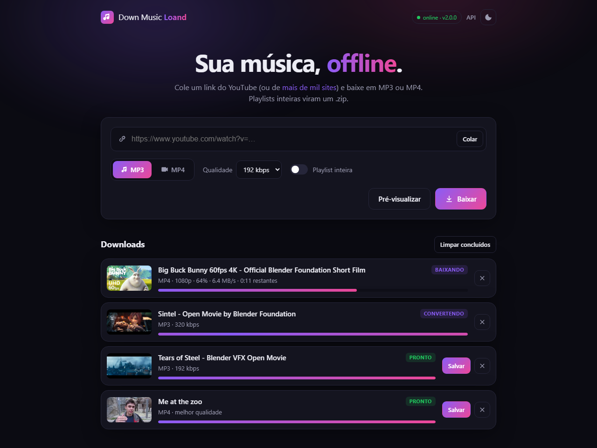

<div align="center">


# Down Music Loand

**Baixe músicas em MP3 e vídeos em MP4 — inclusive playlists inteiras — pelo navegador, no seu próprio servidor.**

FastAPI + yt-dlp no backend, HTML/CSS/JS puro no frontend. Sem build, sem banco, sem conta.

[](https://github.com/VictorTavaresRafael/down-music-loand/actions/workflows/ci.yml)


[](LICENSE)
[](CONTRIBUTING.md)

</div>

<p align="center">
  
</p>

---

## ✨ Funcionalidades

- 🎵 **MP3** com escolha de bitrate (128 / 192 / 320 kbps), capa e metadados embutidos
- 🎬 **MP4** com escolha de resolução (360p até a melhor disponível)
- 📃 **Playlists** completas, entregues num único `.zip`
- 🔎 **Pré-visualização** de título, canal, duração e thumbnail antes de baixar
- 📊 **Progresso em tempo real**: porcentagem, velocidade, tempo restante e item atual da playlist
- 🧵 **Fila de downloads** com limite de downloads simultâneos configurável
- 🌗 Interface responsiva com **tema claro/escuro**
- 📘 Documentação interativa da API em `/docs` (Swagger)
- 🐳 Pronto para **Docker**
- 🌍 Funciona com [mais de mil sites](https://github.com/yt-dlp/yt-dlp/blob/master/supportedsites.md) suportados pelo yt-dlp

## 🚀 Rodando

### Com Docker (mais fácil — já inclui o ffmpeg)

```bash
git clone https://github.com/VictorTavaresRafael/down-music-loand.git
cd down-music-loand
docker compose up --build
```

Abra **http://localhost:8000**. Os arquivos ficam em `./downloads`.

### Localmente

#### Requisitos

- Python **3.11+**
- [**ffmpeg**](https://ffmpeg.org/download.html) no `PATH` (necessário para converter em MP3 e juntar áudio+vídeo)
  - Windows: `winget install Gyan.FFmpeg`
  - macOS: `brew install ffmpeg`
  - Debian/Ubuntu: `sudo apt install ffmpeg`

```bash
cd youtube-downloader
python -m venv venv
# Windows: venv\Scripts\activate   |   Linux/macOS: source venv/bin/activate
pip install -r requirements.txt
uvicorn app.main:app --reload
```

Abra **http://localhost:8000** (frontend) ou **http://localhost:8000/docs** (API).

## ⚙️ Configuração

Tudo via variáveis de ambiente:

| Variável | Padrão | Descrição |
| --- | --- | --- |
| `DOWNLOAD_DIR` | `downloads` | Pasta onde os arquivos são salvos |
| `MAX_CONCURRENT_DOWNLOADS` | `2` | Quantos downloads rodam ao mesmo tempo |
| `MAX_PLAYLIST_ITEMS` | `100` | Limite de itens baixados por playlist |
| `FFMPEG_LOCATION` | — | Caminho do ffmpeg, se não estiver no `PATH` |
| `CORS_ORIGINS` | `*` | Origens permitidas, separadas por vírgula |

## 🔌 API

| Método | Rota | Descrição |
| --- | --- | --- |
| `GET` | `/api/health` | Status do servidor e se o ffmpeg está disponível |
| `POST` | `/api/info` | Metadados de uma URL, sem baixar |
| `POST` | `/api/downloads` | Cria um download (retorna o job) |
| `GET` | `/api/downloads` | Lista os downloads |
| `GET` | `/api/downloads/{id}` | Status/progresso de um download |
| `GET` | `/api/downloads/{id}/file` | Baixa o arquivo final (ou o `.zip` da playlist) |
| `DELETE` | `/api/downloads/{id}` | Remove o download e seus arquivos |

Exemplo:

```bash
curl -X POST http://localhost:8000/api/downloads \
  -H "Content-Type: application/json" \
  -d '{"url": "https://www.youtube.com/watch?v=...", "format": "mp3", "audio_bitrate": "320"}'
```

Corpo aceito por `POST /api/downloads`:

```jsonc
{
  "url": "https://...",        // obrigatório
  "format": "mp3",             // "mp3" | "mp4"
  "playlist": false,           // baixa a playlist inteira se a URL tiver uma
  "quality": "best",           // mp4: "best" | "1080" | "720" | "480" | "360"
  "audio_bitrate": "192"       // mp3: "320" | "192" | "128"
}
```

## 🗂️ Estrutura

```
youtube-downloader/
├── app/
│   ├── main.py              # rotas FastAPI + frontend estático
│   ├── config.py            # variáveis de ambiente
│   ├── models/jobs.py       # schemas Pydantic
│   ├── services/
│   │   ├── downloader.py    # integração com yt-dlp, fila e zip
│   │   └── job_store.py     # estado dos jobs em memória
│   └── static/              # frontend (index.html, styles.css, app.js)
├── tests/                   # pytest (yt-dlp mockado, roda offline)
├── Dockerfile
└── requirements.txt
```

## 🧪 Testes

```bash
cd youtube-downloader
pip install -r requirements-dev.txt
pytest
ruff check .
```

## 🗺️ Roadmap

- [ ] Persistir histórico de downloads (SQLite)
- [ ] Cancelar download em andamento
- [ ] Limpeza automática de arquivos antigos
- [ ] Atualizações de progresso via WebSocket/SSE
- [ ] Recorte de trecho (início/fim) do áudio
- [ ] PWA instalável no celular

Quer pegar algum? Veja o [CONTRIBUTING.md](CONTRIBUTING.md).

## ⚠️ Aviso legal

Este projeto é uma ferramenta para uso pessoal e educacional. **Baixe apenas conteúdo que você tem direito de baixar** — conteúdo seu, em domínio público ou com licença que permita. Respeite os termos de uso das plataformas e os direitos autorais dos criadores.

O servidor foi pensado para rodar **localmente ou numa rede privada**. Se for expor na internet, coloque autenticação na frente (ex.: proxy reverso com basic auth), já que ele faz requisições para qualquer URL recebida.

## 📄 Licença

[MIT](LICENSE) © Victor Tavares Rafael
